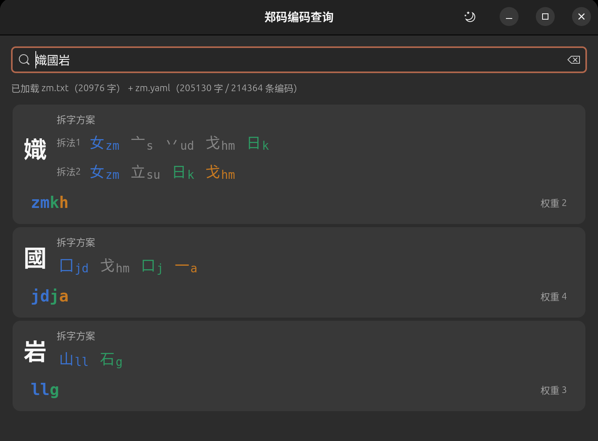

# zmcx · 郑码编码查询

一个用来查汉字**郑码**拆字方案与编码的小工具。输入汉字，逐字展示它拆成了哪些字根、
每个字根各自的码、以及全码和简码；字根与编码按郑码的取码规则着色，能直接看出
哪一位编码是哪个字根出的。


<details>
<summary>深色主题</summary>



</details>

## 功能

- **拆字方案**：逐字根并列展示「字根 + 它自己的码」，如 `岩` → `山ll` `石g`
- **取码位着色**：参与了全码取码的字根按取码先后上色，没参与的留灰
- **全码染色**：全码（多为四键）逐字母回溯到字根，同一字根同色；末尾补码 `vv` / `aa` / `pp` 灰显
- **多字查询**：一次输入多个字，每个字一张卡片；输入词语时额外给出整词编码
- **主题三态**：跟随系统 / 浅色 / 深色，选择会被记住
- **点击复制**：点任意一条编码即可复制

## 环境要求

- Python ≥ 3.9
- PyGObject 与 GTK 4

已在 Python 3.14.4 + PyGObject 3.56.2 + GTK 4.22.4（Ubuntu 26.04）上测试。

## 安装

```bash
# Debian / Ubuntu
sudo apt install python3-gi python3-gi-cairo gir1.2-gtk-4.0

# Fedora
sudo dnf install python3-gobject gtk4

# Arch Linux
sudo pacman -S python-gobject gtk4
```

## 运行

```bash
git clone git@github.com:JunTeamCom/zmcx.git
cd zmcx
python3 zm_gui.py
```

程序按以下顺序查找数据文件 `zm.txt` 与 `zm.yaml`：

1. 环境变量 `ZM_DIR` 指向的目录
2. 脚本所在目录
3. 当前工作目录

```bash
ZM_DIR=/path/to/data python3 zm_gui.py   # 数据放在别处时
```

## 数据文件

| 文件 | 内容 | 规模 |
| --- | --- | --- |
| `zm.txt` | 拆字方案：每个字由哪些字根组成、每个字根在此字中取哪几个码 | 20,976 字 |
| `zm.yaml` | 编码表：字符、编码、权重（权重越小越常用） | 205,130 字 / 214,364 条编码 |

两个文件都是 UTF-8、制表符分隔、行尾 CRLF。

`zm.txt` 每行形如：

```
岩	[山石·ll·g]
```

去掉方括号后，以不间断空格（U+00A0）分隔：第一段是字根，后面是每个字根各自的码，
两者严格一一对应。复合字根用花括号包起来算一个整体：

```
鬻	[弓米弓一口{冈}·yz·uf·yz·a·j·ld]
```

少数条目给了两套拆法，形如 `R1 | R2 C1 | C2`（C1 配 R1、C2 配 R2），共 63 条：

```
値	[亻𠃊十目·|·亻十目𠃊·n·z·ed·l·|·n·ed·l·z]
```

`zm.yaml` 每行是 `字<TAB>编码<TAB>权重`，同一个字可能有多条，程序按权重升序展示。

## 郑码取码规则

依据维基教科书《[郑码输入法/取码](https://zh.wikibooks.org/wiki/郑码输入法/取码)》，一个字最多四键：

| 字根数 | 取码方式 |
| --- | --- |
| 1 个 | 取该字根全码；只有一键时补 `A`（木 `f` → `fa`） |
| 2 个 | 两根各取全码（岩 = 山 `ll` + 石 `g` → `llg`） |
| 3 个 | 首根全取，次根取一键，末根补到第四键 |
| 4 个 | 首根全取；首根仅一键时次根再取一键；末两根各取一键 |

由此可知：**四个字根的字，若首根占两码，次根整根都不取**。例如 `國` 拆作
囗 `jd` + 戈 `hm` + 口 `j` + 一 `a`，全码是 `jdja`，其中并没有 `戈` 的份。
程序里的着色就是按这条规则走的——`戈` 会显示为灰色。

**全码**指每个字的完整取码（通常四键），与 1–3 键的简码相对。用本仓库的码表验证：
214,364 条编码中有 201,935 条正好四键；把全码逐字母回溯到字根，**95.5% 的字可完全对应**，
其余是末尾补码。

## 界面里的颜色

| 颜色 | 含义 |
| --- | --- |
| 蓝 | 第 1 个参与取码的字根 |
| 绿 | 第 2 个 |
| 橙 | 第 3 个 |
| 品红 | 第 4 个 |
| 灰 | 没参与取码的字根；全码末尾的补码 |

编码列表里，**只有全码那一行**带颜色，简码保持原样。

## 已知限制

- 30 个字的全码是纯补码（如 `丶` → `aapp`，码表把它们归到低频兜底码上），
  无法回溯到字根，因此不上色。
- 63 个双拆法字里，全码的颜色对应**最能解释它**的那一套拆法，可能不是列表里的「拆法1」。
- 23 条拆字用到了私用区字符（U+E82C，如 `撫` 的 `扌𠂉▯灬`），常规字体都没有该字形，
  程序用 `▯` 占位并在悬停提示里说明。
- 仅支持 Linux + GTK 4，未做 Windows / macOS 适配。

## 鸣谢

- **承远**：本项目的两份数据文件——拆字方案 `zm.txt` 与编码表 `zm.yaml`——全部来自
  承远发布的数据。承远是郑码社区的核心成员，这两份数据让这个查询工具
  得以直接可用，在此郑重致谢。
- **郑易里、郑珑**：郑码由郑易里先生发明，后由其女儿郑珑等完成实现与推广。
  感谢他们创造出这套字形编码方案。

## 许可

代码以 [MIT 许可证](LICENSE) 发布，版权归 JunTeamCom 所有。

**数据文件（`zm.txt`、`zm.yaml`）不在 MIT 许可证范围内**，来源于承远的公开发布。
郑码本身由郑易里、郑珑等发明，码表的著作权归属以其权利人的说明为准；本仓库收录
这两份数据是为了让程序可以直接运行，方便学习与研究。如相关权利人提出异议，将移除
相关数据。用于商业用途前请自行确认授权。

## 参考

- [郑码 — 维基百科](https://zh.wikipedia.org/wiki/郑码)
- [郑码输入法/取码 — 维基教科书](https://zh.wikibooks.org/wiki/郑码输入法/取码)
